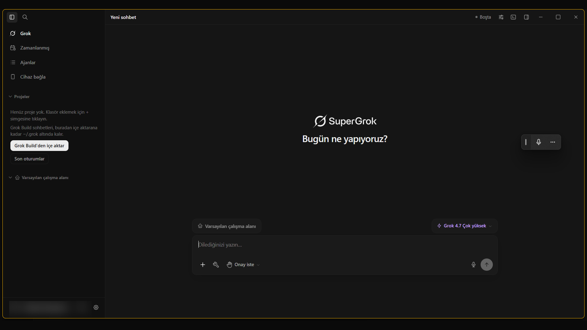
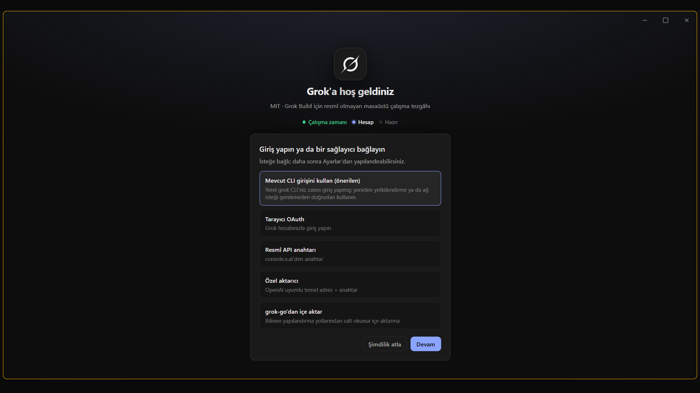
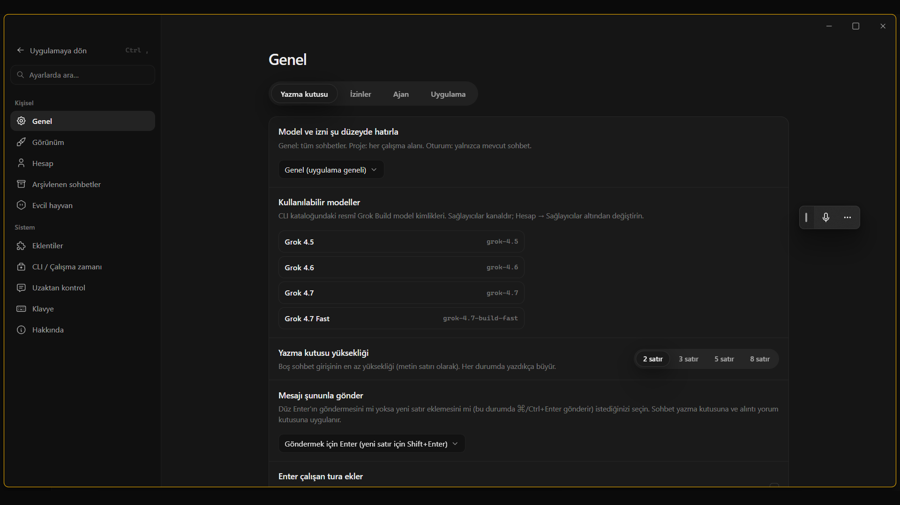
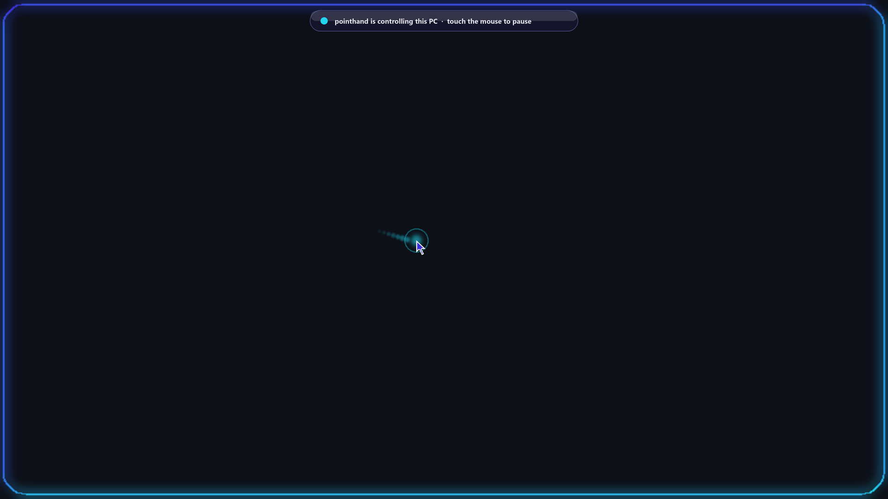

<div align="center">

# GrokCLI

**A fast, stable Windows desktop app for the Grok CLI.**

[](https://github.com/ayzekhdawy/grokcli/actions/workflows/ci.yml)
[](LICENSE)

[Website](https://grok.noniux.com) · [Download](https://github.com/ayzekhdawy/grokcli/releases) · [Privacy](https://grok.noniux.com/privacy) · [Türkçe](README.tr.md)

</div>



## What is GrokCLI?

GrokCLI is a desktop app (Tauri 2 + WebView2) that runs on top of the `grok` command-line agent on your own machine. Your chats, sessions, approvals and files stay local. The app gives the CLI a fast, keyboard-friendly interface and does not replace it.

## Features

- **Chat and sessions:** stream agent replies live, pin chats, and resume or switch sessions instantly.
- **Approvals:** review tool calls and approve or deny them inline.
- **Floating pet hub:** a mascot that stays on your desktop and opens a quick-access panel:
  - prompt box: `Enter` sends in the background, `Ctrl+Enter` sends and opens the chat
  - voice dictation
  - a session switcher with live status (waiting for approval, running, idle)
  - Approve, Deny and Stop actions without opening the main window
  - up to 12 saved prompts
  - global hotkey `Alt+Win+P`
- **PointHand computer use (Windows):** one click fills the [PointHand](https://github.com/ayzekhdawy/pointhand) MCP server and installs its skill, so the agent can see the screen and work in desktop apps. See [docs/pointhand.md](docs/pointhand.md).
- **Full Turkish UI**, alongside English.
- **Stability work:** non-blocking window and IPC handling, a recovering connect lock, and guard tests against UI freezes.

## Screenshots

| Welcome | Settings | Floating pet |
| --- | --- | --- |
|  |  |  |

## PointHand: give the agent a hand on Windows

<p align="center"></p>

[PointHand](https://github.com/ayzekhdawy/pointhand) is an open-source Windows computer-use MCP server. In **Settings → Extensions → MCP → Add server**, click **Fill in PointHand**, point it at your extracted `client/dist/index.js` and press **Add**. **Install PointHand skill** teaches the agent the look → act → verify workflow. Physical Escape stops it at any time. Full guide: [docs/pointhand.md](docs/pointhand.md).

| Drawn in Paint by PointHand (real output) | Activity overlay (from the PointHand repo) |
| :---: | :---: |
|  |  |

## Install

1. Install and sign in to the Grok CLI (`grok` must be on your `PATH`).
2. Download the latest `GrokCLI_x.y.z_x64-setup.exe` from [Releases](https://github.com/ayzekhdawy/grokcli/releases).
3. Run the installer. The installer is not code-signed yet, so Windows SmartScreen may warn you. Choose **More info → Run anyway**.

**Requirements:** Windows 10/11 x64, WebView2 (included with Windows 11), and the Grok CLI.

## Build from source

You need Node.js 22, pnpm, and stable Rust with the MSVC toolchain.

```bash
pnpm install
pnpm tauri dev                     # development app with hot reload
pnpm tauri build --bundles nsis    # Windows installer
```

Tagged pushes (`v*`) build the installer in CI and attach it to the GitHub release.

## Contributing

Issues and pull requests are welcome. See [CONTRIBUTING.md](CONTRIBUTING.md), [SECURITY.md](SECURITY.md) and the [Code of Conduct](CODE_OF_CONDUCT.md).

## License

[MIT](LICENSE).

## Acknowledgements

GrokCLI is a fork of [RongleCat/grok-app](https://github.com/RongleCat/grok-app) (MIT). Thanks to its author and contributors. The original copyright notice is kept in [LICENSE](LICENSE).
